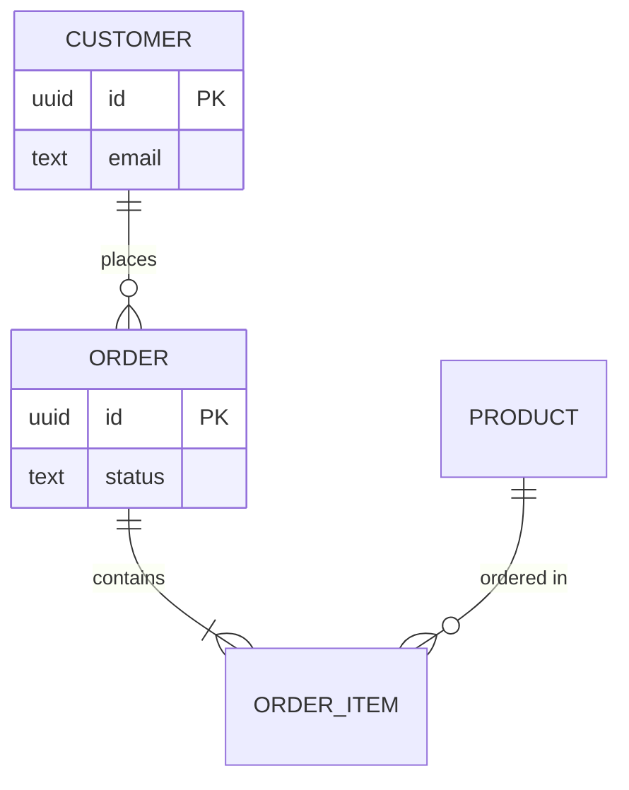

# Backend Schema Document

Owns the data model as documented *meaning*: tables and their purpose, columns and
real types, relationships, constraints and indexes, enum/lookup values, the intent
behind non-obvious structures, data classification/retention, and traceability to
the requirements each table serves. Derives from the TRD.

**Boundaries (do not duplicate).**
- **TRD Sec.  Data design** = high-level storage choices, ownership, consistency, and
  retention. This document is the detailed, authoritative model under it.
- **PRD** = user stories. This document traces each table back to the story or rule
  that asked for it (see Sec.  Traceability).
- **Division of authority.** The **migrations are the authority on structure**;
  this document is the **authority on meaning** (what a column *means*, allowed
  values, who may change it). They change and get reviewed together - a migration
  with no matching change here is a review question, not a pass.

**Large schema:** if the model has many domains, split into `docs/schema/<domain>.md`
and keep this file as the index (one file per domain, linked). Never one mega-file.

Write to `docs/BACKEND_SCHEMA.md`.

---

# <Project / Feature> - Backend Schema

## 0. Header
| Field | Value |
|---|---|
| Status | draft / in review / approved |
| Owner | <name> |
| Reviewers | <names> |
| Last updated | <date> |
| Version | <v0.1> |
| DB engine & version | <e.g. PostgreSQL 16> |
| Related | [TRD.md](TRD.md) |

## 1. Overview & purpose
<The data model in one paragraph: the main entities and how they relate, and what
this document covers.>

## 2. Conventions
State the rules every table follows, so the model is consistent:
- Naming: <snake_case tables plural, columns singular, e.g. `orders.customer_id`>
- Primary keys: <uuid v7 / bigint identity> - why
- Timestamps: <created_at / updated_at, timezone = UTC>
- Soft delete: <deleted_at pattern, or hard delete - and where>
- Foreign keys: <naming `<table>_id`, on-delete default>
- Money / decimals: <integer minor units / numeric(..., ...)>
- Enums: <native enum vs lookup table - and why>

## 3. ERD
Draw the model with **Mermaid** `erDiagram` (cardinality is native: `||--o{`). This is a **derived view** of Sec. 4 (data dictionary) and Sec. 6 (relationships) - those tables are authoritative; update the diagram in the same change, and a mismatch is a review question. Split by domain when the model is large.

- Entities: <list the entities and the one-line relationship between them>

## 4. Tables / data dictionary
One block per table. Every column states its **meaning**, not just its type - a
diagram shows structure, this table explains what the value *is*.

### <table_name>
- **Purpose:** <why this table exists>
- Columns:

| Column | Type | Null | Default | Constraint | Meaning | PII |
|---|---|---|---|---|---|---|
| id | uuid | no | gen | PK | Row identity | no |
| status | text | no | 'new' | FK/check | Lifecycle state (see Sec. 5) | no |
| <col> | <real type> | | | | <semantic meaning> | yes/no |

## 5. Enums & lookup values
Diagram labels like `status` do not explain themselves. Define every allowed value
and who may set it.
| Field | Allowed values | Meaning of each | Set by |
|---|---|---|---|
| orders.status | new / paid / shipped / returned | <meaning> | <system / role> |

## 6. Relationships & referential actions
| From | To | Cardinality | On delete | On update |
|---|---|---|---|---|
| <table.col> | <table.col> | 1-N | cascade / restrict / set null | <...> |

## 7. Constraints & indexes
| Table | Constraint / Index | Columns | Why |
|---|---|---|---|
| <table> | unique | (<cols>) | <business rule it enforces / query it speeds> |

## 8. Normalization & denormalization decisions
- Normal form target: <3NF by default>
- Deliberate denormalizations: <column/copy - and the read path that justified it>
- Trade-off: <consistency vs join cost>

## 9. Data classification, retention & compliance
| Table / column | Classification | Holds personal data? | Retention | Deletion |
|---|---|---|---|---|
| <users.email> | PII | yes | <period> | <hard delete on request> |

- Regulatory: <GDPR / data residency / audit requirements>
- Backup & recovery: <what is backed up, how often, restore target>

## 10. Traceability
Every table should be able to explain why it exists.
| Table | User story / rule (PRD) | Notes |
|---|---|---|
| <table> | US1, BR3 | <...> |

## 11. Migrations & versioning
- Tool: <ORM/migration tool>
- Migrations are the authority on structure; keep this document in sync in the same
  change.
- Latest migration: <id/name> - Rollback approach: <down migration / forward-fix>
- Destructive-change policy: <expand-then-contract, backward compatible>

## 12. Freshness & change log
| Version | Date | Author | Change |
|---|---|---|---|
| v0.1 | <date> | <name> | Initial model |

- Last updated: <date> - Schema version: <...>

## 13. Open questions
| # | Question | Owner | Needed by |
|---|---|---|---|
| Q1 | <...> | <name> | <date> |

## 14. Links
- Upstream: [TRD.md](TRD.md) - [PRD.md](PRD.md)
