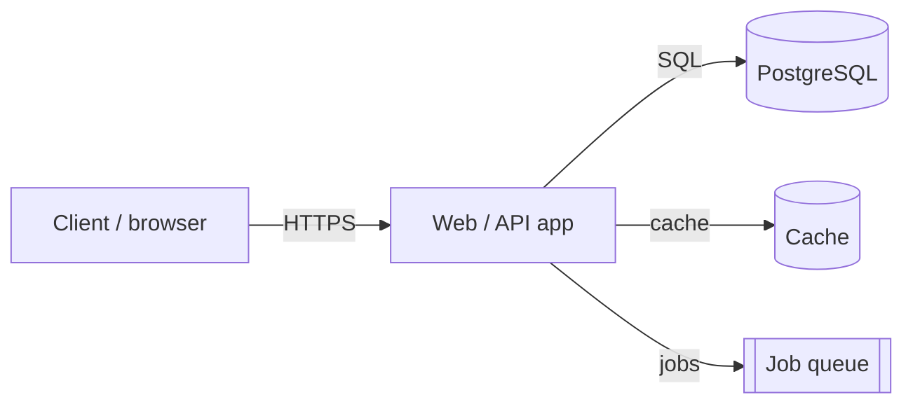

# Technical Requirements Document (TRD)

Owns how the system is built: the technical obligations the solution must meet -
functional and non-functional requirements, architecture, data design, interfaces,
security, observability, and rollout. Derives from the PRD; feeds the schema and
the implementation plan.

**Boundaries (do not duplicate).**
- **PRD** = product intent: what/why, user stories, product-level NFR *constraints*,
  business risks.
- **TRD (here)** = technical obligations: requirements with *numbers*, architecture,
  interfaces, high-level data design, security, observability, deployment.
- **BACKEND_SCHEMA** = the detailed data model (tables, columns, real types, ERD,
  indexes, migrations). The TRD only states storage choices, ownership, and retention.
- **APP_FLOW** = the user journey. The TRD's "data flow" is the technical request path.

A requirement is written so a test can accept or reject it. Where a decision is a
choice between options, record the option chosen and why; the detailed build steps
belong in the implementation plan, not here.

Write to `docs/TRD.md`.

---

# <Project / Feature> - Technical Requirements

## 0. Header
| Field | Value |
|---|---|
| Status | draft / in review / approved |
| Owner | <name> |
| Reviewers | <names> |
| Last updated | <date> |
| Version | <v0.1> |
| Related | [PRD.md](PRD.md) |

**Change log**
| Version | Date | Author | Change |
|---|---|---|---|
| v0.1 | <date> | <name> | Initial draft |

## 1. Overview
<One paragraph: the technical shape of the solution and the key decisions. What
this TRD covers, and what it deliberately leaves to other documents.>

## 2. Technical scope
- In scope: <services / modules / surfaces this TRD governs>
- Out of scope: <what is not covered here, and where it lives>
- Constraints inherited from the PRD: <link to PRD non-functional constraints>

## 3. Functional requirements
Decompose the PRD's user stories into buildable, testable technical requirements.
| ID | Requirement | Traces to (US) | Priority (MoSCoW) | Acceptance |
|---|---|---|---|---|
| FR1 | <behaviour the system must provide> | US1 | Must | <testable condition> |

## 4. Non-functional requirements (numbers required)
| Area | Requirement | Target |
|---|---|---|
| Performance | API latency / page load | <e.g. p95 < 300 ms> |
| Capacity | Concurrent users / throughput | <number> |
| Reliability | Uptime / error budget | <e.g. 99.9%> |
| Scalability | Growth assumption | <...> |
| Security | Standard / posture | <e.g. OWASP ASVS L2> |
| Accessibility | Standard | <e.g. WCAG 2.2 AA> |
| Maintainability | Coverage / complexity budget | <...> |

> Every NFR carries a number and, where relevant, the measurement point.

## 5. System architecture
- **Pattern & why:** <monolith / modular / services / serverless - and why it fits the constraints>
- **Diagram (derived view):** **Mermaid** `flowchart LR` - components and the request path; mirrors the component table below, which is authoritative. Update both in the same change. Avoid Mermaid C4 / `architecture-beta` (experimental, often fails to render).

- **Components & responsibilities:**
  | Component | Responsibility | Technology |
  |---|---|---|
  | <name> | <what it owns> | <stack> |
- **Data flow:** <request path in a few steps, client -> API -> data -> response>

## 6. Tech stack & constraints
- Language / framework / database / hosting: <...>
- Constraints: <platform, budget, existing systems, team skills, licensing>
- Key decisions & rejected alternatives: <option chosen - why; what was rejected and why>

## 7. Data design (high level)
Detailed tables and types live in `BACKEND_SCHEMA.md`; this section states the shape.
- Storage choices & rationale: <relational / document / cache / object store - and why>
- Main entities & ownership: <who owns which data>
- Consistency & transactions: <where strong vs eventual consistency is required>
- Retention & archival: <how long, where, deletion policy>
- Link: [BACKEND_SCHEMA.md](BACKEND_SCHEMA.md)

## 8. Interfaces & integrations
| Interface | Type (REST/GraphQL/event) | Auth | Rate limit | Notes |
|---|---|---|---|---|
| <endpoint / event> | <type> | <auth> | <e.g. 100 rpm/key> | <...> |

- API contract: <link to OpenAPI/Swagger or schema - finalized before review>
- External dependencies: <third-party APIs, SLAs, failure behaviour>

## 9. Security & compliance
- Threat model: <key threats and trust boundaries>
- Data sensitivity: <PII, secrets, payment data, retention>
- Controls: <authn/authz model, input validation, output encoding, encryption at rest/in transit>
- Secrets management: <where secrets live, rotation>
- Compliance: <GDPR / SOC2 / data residency, if applicable>

## 10. Observability
- Logging: <what is logged, format, correlation id; never log secrets/PII>
- Metrics: <key metrics and their thresholds>
- Tracing: <spans across components>
- Alerting & SLOs: <what pages a human, error-budget policy>

## 11. Deployment, migration & rollout
- Environments: <dev / staging / prod and how they differ>
- Migration strategy: <schema/data migrations, backward compatibility>
- Rollout: <big-bang / canary / progressive exposure; feature flags>
- Rollback: <how to reverse a bad deploy and a bad migration>
- Smoke checks: <post-deploy checks that must pass>

## 12. Assumptions, dependencies & technical risks
- Assumption: <...> (default if wrong: <...>)
- Dependency: <service / team / decision / external>
- **Technical risks**
  | Risk | Likelihood | Impact | Mitigation |
  |---|---|---|---|
  | <technical risk> | low/med/high | low/med/high | <...> |

## 13. Open questions
| # | Question | Owner | Needed by |
|---|---|---|---|
| Q1 | <...> | <name> | <date> |

## 14. Acceptance / Definition of Done (technical)
- [ ] Every Must FR meets its acceptance and has a test.
- [ ] Every NFR target is measurable and has a check.
- [ ] Security controls reviewed; no secrets in code or client.
- [ ] Rollout and rollback exercised in staging.

## 15. Links
- Upstream: [PRD.md](PRD.md) - Data model: [BACKEND_SCHEMA.md](BACKEND_SCHEMA.md) - Flow: [APP_FLOW.md](APP_FLOW.md) - Plan: [IMPLEMENTATION_PLAN.md](IMPLEMENTATION_PLAN.md)
